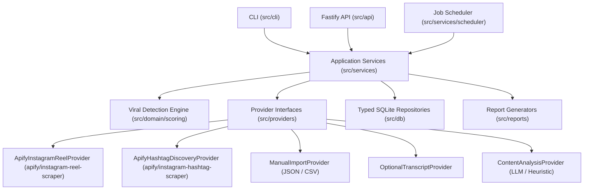

# REEL RADAR — Architecture Overview

## 1. System Purpose
**Reel Radar** is a local-first Instagram Viral Intelligence Platform designed to discover public Instagram Reels, identify creator-relative breakout videos, monitor competitor watchlists, discover emerging competitor accounts, track metric velocity over time, and generate evidence-backed research reports.

## 2. Layered Modular Architecture

### Core Boundaries
1. **Domain Layer (`src/domain/`)**:
   - Pure TypeScript entities, Zod validation schemas, and the deterministic **Viral Detection Engine** (`src/domain/scoring.ts`).
   - Completely independent of external APIs, SQLite details, or LLM providers.
2. **Persistence Layer (`src/db/`)**:
   - Maintained `better-sqlite3` database connection with WAL mode, foreign keys (`PRAGMA foreign_keys = ON`), idempotent versioned migrations (with up/down rollback support), and transactional repositories.
   - Preserves historical `MetricSnapshot` rows for every collection run rather than overwriting prior metrics.
3. **Provider Layer (`src/providers/`)**:
   - Strictly separated interfaces:
     - `ReelCollectionProvider`: Collects recent Reels for known public accounts (`apify/instagram-reel-scraper` or `ManualImportProvider`).
     - `ReelDiscoveryProvider`: Discovers public Reels across hashtags/keywords (`apify/instagram-hashtag-scraper`).
     - `CompetitorDiscoveryProvider`: Controlled candidate discovery loop with niche relevance scoring and explicit watchlists approval gates.
     - `TranscriptProvider`: Optional transcription adapter with explicit language, confidence, and cost controls.
     - `ContentAnalysisProvider`: Evidence-backed structured JSON analysis cached by Reel content fingerprint, model, and prompt version.
4. **Application Services (`src/services/`)**:
   - Orchestrates collection pipelines, competitor discovery, viral scoring, AI analysis, caching, cost estimation, and background scheduling.
5. **Reporting & Interfaces (`src/reports/`, `src/cli/`, `src/api/`)**:
   - Markdown and CSV report writers (`viral-reels.md`, `competitor-accounts.csv`, `emerging-topics.md`, `content-opportunities.md`, `collection-health.md`).
   - Full CLI (`pnpm cli ...`) and Fastify REST API (`pnpm dev`).
