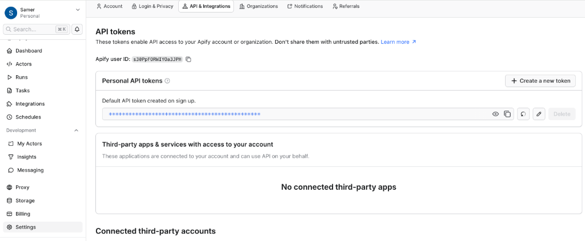
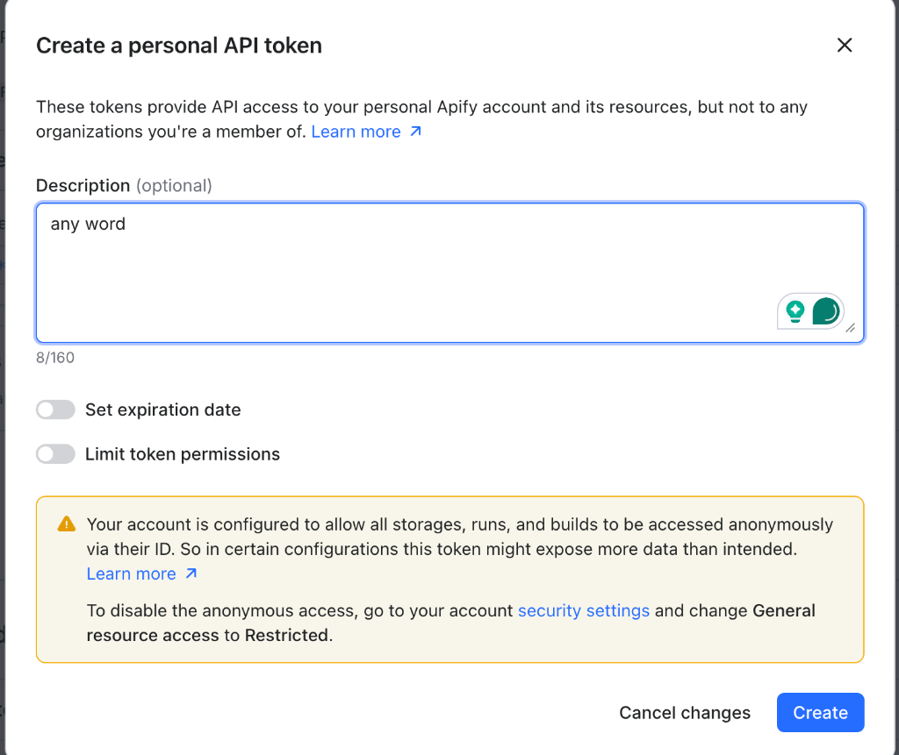
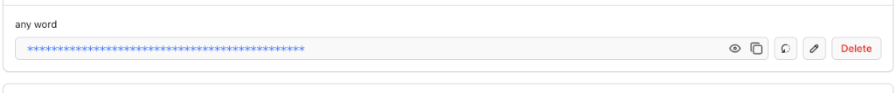

<div dir="rtl" align="right">

# ⚡ REEL RADAR — منصة الذكاء الفيروسي واكتشاف ريلز إنستغرام

<p align="right">
  <strong>تم التطوير بواسطة: SAMER IBRAHIM</strong><br/>
  <a href="https://www.facebook.com/samibra11/" target="_blank">
    
  </a>
  <a href="https://www.instagram.com/sam_ibra1" target="_blank">
    
  </a>
</p>

**Reel Radar** هي أداة احترافية تعمل محلياً (Local-First) لاكتشاف مقاطع ريلز إنستغرام الفيروسية (Breakout Reels)، ومراقبة حسابات المنافسين، والبحث بالكلمات المفتاحية أو الهاشتاجات، وتحليل المحتوى بالذكاء الاصطناعي مع واجهة ويب تفاعلية وتقارير مفصلة.

---

## 📌 فهرس المحتويات
1. [ما الذي تقدمه الأداة؟](#-1-ما-الذي-تقدمه-الأداة)
2. [التشغيل الذكي والسريع عبر Claude Code أو Codex](#-2-التشغيل-الذكي-والسريع-عبر-claude-code-أو-codex)
3. [التشغيل العادي بضغطة واحدة (بدون أوامر معقدة)](#-3-التشغيل-العادي-بضغطة-واحدة)
4. [طريقة استخراج مفتاح Apify بالصور (خطوة بخطوة)](#-4-طريقة-استخراج-مفتاح-apify-بالصور-خطوة-بخطوة)
5. [طريقة تركيب مفتاح Apify داخل الأداة (طريقتان سهلتان)](#-5-طريقة-تركيب-مفتاح-apify-داخل-الأداة)
6. [شرح استخدام واجهة الويب (Dashboard)](#-6-شرح-استخدام-واجهة-الويب-dashboard)
7. [التقارير التلقائية ومخرجات النظام](#-7-التقارير-التلقائية-ومخرجات-النظام)

---

## 🚀 1. ما الذي تقدمه الأداة؟

- **اكتشاف الفيديوهات الضاربة (Outlier Detection):** حساب متوسط مشاهدات كل صانع محتوى ومقارنة كل ريلز جديد بأدائه المعتاد لاكتشاف الفيديوهات التي حققت قفزة غير عادية (مثلاً `5x` أو `10x` ضعف مشاهداته المعتادة).
- **البحث بالكلمات المفتاحية والهاشتاجات:** جلب أحدث وأقوى الريلز في أي مجال (مثل: `ai`, `claude`, `chatgpt`, `motion`) أو من حسابات محددة (مثل: `@github`, `@vercel`).
- **معاينة الفيديو مباشرة (Reel Preview):** مشاهدة الفيديو أو صورة الغلاف وقراءة الوصف وتفاصيل التحليل من داخل لوحة التحكم مع زر الانتقال المباشر إلى إنستغرام.
- **توليد 5 تقارير بحثية جاهزة:** تقارير بصيغة Markdown و CSV تتضمن روابط المصادر، والمواضيع الصاعدة، وأفكار محتوى جديدة قابلة للتطبيق.

---

## 🤖 2. التشغيل الذكي والسريع عبر Claude Code أو Codex

إذا كنت تستخدم **Claude Code** أو **OpenAI Codex CLI** (أو أي مساعد برمجي ذكي مثل Cursor / Antigravity)، لا تحتاج لكتابة أي أوامر يدوية! فقط انسخ الأمر (Prompt) التالي والصقه ليتولى المساعد تحميل المشروع وتثبيت الحزم وتشغيل الواجهة لك تلقائياً:

### 📋 انسخ هذا الأمر والصقه مباشرة داخل Claude Code أو Codex:
```text
قم بتحميل مشروع Reel Radar من الرابط https://github.com/samerquta/reel-radar.git ثم ادخل إلى المجلد وثبّت الحزم وشغّل النظام على المنفذ 3000 وافتح لي الرابط في المتصفح.
```

*(أو إذا قمت بتحميل المجلد مسبقاً على جهازك، افتح **Claude Code** أو **Codex** داخل المجلد واكتب فقط: **`شغل المشروع`** أو **`run this project`** وسيقوم بتشغيل `./start.sh` وفتح لوحة التحكم لك فوراً!).*

### ⚡ تشغيل عبر الطرفية باستخدام أمر واحد فقط (One-Liner):
يمكنك أيضاً لصق هذا السطر الواحد في الطرفية (Terminal) ليقوم بكل شيء تلقائياً من الصفر:
```bash
git clone https://github.com/samerquta/reel-radar.git && cd reel-radar && ./start.sh
```

---

## 💻 3. التشغيل العادي بضغطة واحدة

تحتاج فقط إلى وجود **[Node.js](https://nodejs.org/)** مثبت على جهازك.

### طريقة التشغيل المباشر:
- **على نظام Mac أو Linux:**
  افتح الطرفية (Terminal) داخل مجلد المشروع وشغّل الأمر:
  ```bash
  ./start.sh
  ```
- **على نظام Windows:**
  انقر نقراً مزدوجاً على الملف:
  ```text
  start.bat
  ```
- **أو يدوياً عبر `pnpm`:**
  ```bash
  pnpm install
  pnpm dev
  ```

بعد التشغيل، ستفتح الواجهة تلقائياً على الرابط:
**[http://127.0.0.1:3000](http://127.0.0.1:3000)**

---

## 🔑 4. طريقة استخراج مفتاح Apify بالصور (خطوة بخطوة)

تعتمد الأداة على منصة **Apify** لجلب بيانات ريلز إنستغرام العامة. يمكنك الحصول على مفتاح مجاني باتباع الخطوات الثلاث التالية:

### الخطوة الأولى: الدخول إلى إعدادات API في موقع Apify
1. سجل الدخول أو أنشئ حساباً مجانياً في موقع **[Apify Console](https://console.apify.com/)**.
2. من القائمة الجانبية اليسرى اضغط على **Settings** ← ثم اختر تبويب **API & Integrations** من الأعلى ← ثم اضغط على زر **`+ Create a new token`** (أو انسخ المفتاح الافتراضي الموجود لديك).



---

### الخطوة الثانية: إنشاء مفتاح شخصي جديد (Create Token)
ستظهر لك نافذة فرعية بعنوان **Create a personal API token**:
1. في خانة **Description** اكتب أي اسم تذكيري (مثل: `reel-radar` أو `any word`).
2. اضغط على الزر الأزرق **Create** في أسفل النافذة.



---

### الخطوة الثالثة: نسخ المفتاح (Copy API Token)
بعد إنشاء المفتاح، سيظهر في قائمة **Personal API tokens**؛ اضغط على **أيقونة النسخ (📋)** بجانب الرمز المشفر لنسخ مفتاحك (الذي يبدأ بـ `apify_api_...`).



---

## 🛠️ 5. طريقة تركيب مفتاح Apify داخل الأداة

وفرنا لك **طريقتين سهلتين جداً** لتركيب المفتاح الخاص بك دون الحاجة لأي خبرة برمجية:

### الطريقة الأولى (الأسهل): من داخل واجهة الويب مباشرة 🌐
1. افتح الواجهة على المتصفح: **[http://127.0.0.1:3000](http://127.0.0.1:3000)**.
2. في الشريط العلوي، اضغط على زر **`⚠️ Set Apify Key`** (أو زر **`Key: ...`** لتحديثه).
3. ستفتح لك نافذة إعداد المفتاح ← الصق مفتاحك (`apify_api_...`) في الحقل المخصص.
4. اضغط على زر **Save Key**.
5. سيتحول المؤشر في الأعلى إلى اللون الأخضر (**Key Active**)، ويتم حفظ المفتاح تلقائياً في ملف `apify-key.txt` داخل مجلد المشروع.

### الطريقة الثانية: عبر ملف `apify-key.txt` المنفصل 📄
1. داخل المجلد الرئيسي للمشروع، ستجد ملفاً باسم [`apify-key.example.txt`](./apify-key.example.txt).
2. افتح الملف بأي محرر نصوص عادي (Notepad أو TextEdit)، والصق مفتاحك بداخله.
3. احفظ الملف باسم **`apify-key.txt`** في نفس المجلد، وسيقوم النظام بقراءته تلقائياً فور التشغيل.

---

## 🖥️ 6. شرح استخدام واجهة الويب (Dashboard)

بعد فتح **[http://127.0.0.1:3000](http://127.0.0.1:3000)** وتركيب المفتاح، يمكنك استخدام الواجهة كالتالي:

1. **شريط البحث والجلب المباشر (Search & Run Bar):**
   - **للبحث بالهاشتاجات أو المواضيع:** اكتب الكلمات مفصولة بفاصلة مثل: `claude, chatgpt, motion, ai` ثم اضغط **Run Scraper**.
   - **لجلب ريلز حساب معين:** اكتب اسم الحساب مسبوقاً بعلامة `@` مثل: `@github` أو `@vercel` ثم اضغط **Run Scraper**.
   - **زر Filter:** يقوم بتصفية النتائج المخزنة لديك حالياً في قاعدة البيانات بشكل فوري دون استهلاك رصيد Apify.
2. **التبويبات (Tabs):**
   - **🔥 Viral Breakouts:** يرتب الفيديوهات من الأعلى إلى الأقل حسب درجة الانتشار الفيروسي (`Score`) ونسبة التفوق على متوسط الحساب (`Outlier Ratio`).
   - **🕒 Newest Reels:** يرتب الفيديوهات من الأحدث نشراً إلى الأقدم.
3. **معاينة الفيديو والتفاصيل (Reel Preview Modal):**
   - اضغط على صورة أي ريلز أو زر **Preview** لفتح نافذة المعاينة الكاملة التي تعرض الفيديو، عدد المشاهدات، نسبة التفوق، الوصف الكامل، وملخص الذكاء الاصطناعي (الهوك، الموضوع، ونمط المحتوى)، مع زر **Open on Instagram** لفتحه في إنستغرام.

---

## 📊 7. التقارير التلقائية ومخرجات النظام

مع كل عملية جلب أو عند تشغيل أمر التقارير، ينشئ النظام 5 ملفات داخل مجلد `./reports/`:

| اسم التقرير | الوصف والمحتوى |
| :--- | :--- |
| [`reports/viral-reels.md`](./reports/viral-reels.md) | جدول وتفاصيل جميع الريلز مرتبة حسب قوة الانتشار مع روابطها المباشرة وتحليلها. |
| [`reports/competitor-accounts.csv`](./reports/competitor-accounts.csv) | ملف جدول بيانات (يفتح في Excel) يحتوي على الحسابات، عدد المتابعين، متوسط المشاهدات، وعدد الفيديوهات الضاربة. |
| [`reports/emerging-topics.md`](./reports/emerging-topics.md) | المواضيع والهاشتاجات الصاعدة التي تكررت لدى صانعي محتوى متعددين مع روابط الفيديوهات الداعمة. |
| [`reports/content-opportunities.md`](./reports/content-opportunities.md) | أفكار محتوى أصلية مقترحة للتجربة (الهوك المقترح ← المشكلة ← الهيكل السردي ← دعوة التفاعل CTA). |
| [`reports/collection-health.md`](./reports/collection-health.md) | تقرير حالة البيانات، اكتمال الحقول، وسجل عمليات الجلب. |

---

## 👨‍💻 مطور الأداة والتواصل (Author & Social Links)

تم تصميم وتطوير هذه الأداة بواسطة **SAMER IBRAHIM**. يسعدني تواصلكم ومتابعتكم عبر الحسابات الرسمية:

- **الاسم:** `SAMER IBRAHIM`
- **فيسبوك:** [facebook.com/samibra11](https://www.facebook.com/samibra11/)
- **إنستغرام (`@sam_ibra1`):** [instagram.com/sam_ibra1](https://www.instagram.com/sam_ibra1)

</div>

---

# 🌍 REEL RADAR — Instagram Viral Intelligence Platform (English Guide)

<p align="left">
  <strong>Created & Engineered by SAMER IBRAHIM</strong><br/>
  <a href="https://www.facebook.com/samibra11/" target="_blank">
    
  </a>
  <a href="https://www.instagram.com/sam_ibra1" target="_blank">
    
  </a>
</p>

**Reel Radar** is a local-first Instagram Viral Intelligence application that discovers public Instagram Reels, identifies creator-relative breakout videos, monitors competitor watchlists, tracks performance velocity, and generates evidence-backed research reports with an interactive web dashboard.

---

## 🤖 1. Instant Launch with Claude Code or OpenAI Codex

If you use **Claude Code** (`claude`), **OpenAI Codex** (`codex`), or any AI coding agent, you don't need to run manual commands. Just copy and paste the prompt below into your AI agent:

### 📋 Copy & Paste into Claude Code / Codex:
```text
Clone https://github.com/samerquta/reel-radar.git, install dependencies, start the Reel Radar server on port 3000, and open http://127.0.0.1:3000 in my browser.
```

*(If you already downloaded the project folder, just open **Claude Code** or **Codex** inside the folder and type: **`run the project`** or **`شغل النظام`** — the project includes built-in `CLAUDE.md` and `AGENTS.md` instructions so the agent knows how to launch it automatically!)*

### ⚡ One-Line Terminal Command:
```bash
git clone https://github.com/samerquta/reel-radar.git && cd reel-radar && ./start.sh
```

---

## ⚡ 2. Standard Quick Start & One-Click Launch

Make sure **[Node.js (LTS)](https://nodejs.org/)** is installed on your machine.

### Launch the Platform:
- **Mac / Linux:**
  ```bash
  ./start.sh
  ```
- **Windows:**
  Double-click `start.bat`
- **Manual CLI:**
  ```bash
  pnpm install
  pnpm dev
  ```

Once started, open **[http://127.0.0.1:3000](http://127.0.0.1:3000)** in your browser.

---

## 🔑 3. How to Get Your Apify API Key (Step-by-Step)

1. **Open Apify Settings:** Log in to **[Apify Console](https://console.apify.com/)**, click **Settings** in the bottom-left sidebar &rarr; select the **API & Integrations** tab &rarr; click **`+ Create a new token`**.
   

2. **Create a Personal Token:** Enter any label in the **Description** field (e.g., `reel-radar`) and click **Create**.
   

3. **Copy Your Token:** Click the **Copy icon (📋)** next to your newly created token (`apify_api_...`).
   

---

## 🛠️ 4. How to Configure Your Apify Key in Reel Radar

You do **not** need to edit hidden `.env` files. Choose either method below:

### Method A: Directly from the Web UI (Recommended)
1. Open **[http://127.0.0.1:3000](http://127.0.0.1:3000)**.
2. Click the **`⚠️ Set Apify Key`** button in the top navigation bar.
3. Paste your `apify_api_...` token into the input box and click **Save Key**.
4. Your key is saved automatically to `apify-key.txt` (which is gitignored for security) and activated immediately.

### Method B: Using the `apify-key.txt` File
1. Open [`apify-key.example.txt`](./apify-key.example.txt) in the project root folder.
2. Paste your Apify token inside and save/rename the file as **`apify-key.txt`**.

---

## 🖥️ 5. Using the Web Dashboard & CLI

### Web Dashboard (`http://127.0.0.1:3000`)
- **Search & Run Scraper:** Enter comma-separated hashtags/keywords (`ai, claude, chatgpt, motion`) or Instagram handles (`@github, @vercel`) and click **Run Scraper** to trigger a live Apify job with a loading indicator.
- **Instant Local Filter:** Click **Filter** (or any quick filter chip) to filter already-collected Reels in real time.
- **Tabs:** Switch between **🔥 Viral Breakouts** (sorted by creator-relative outlier score) and **🕒 Newest Reels** (sorted by publication date).
- **Reel Preview Modal:** Click any Reel card or **Preview** to watch the video/thumbnail, inspect its outlier ratio, read the full caption, and view AI hook/pattern analysis.

### CLI Commands (`pnpm cli ...`)
```bash
# Watchlist Management
pnpm cli account add <username> --niche "AI & Automation"
pnpm cli account list
pnpm cli account approve <username>
pnpm cli account exclude <username>

# Live Collection & Discovery
pnpm cli collect --username <username> --limit 15
pnpm cli collect --active-accounts --limit 15
pnpm cli discover --hashtag "ai,claude,chatgpt,motion" --max-posts 15

# Offline Import, Scoring, AI Analysis & Reports
pnpm cli import --file ./sample-data/reels.json
pnpm cli score
pnpm cli analyze --top 25
pnpm cli report --output ./reports
pnpm cli status
```

---

## 👨‍💻 Author & Connect

Built with precision by **SAMER IBRAHIM**. Connect on social media:

- **Facebook:** [https://www.facebook.com/samibra11/](https://www.facebook.com/samibra11/)
- **Instagram (`@sam_ibra1`):** [https://www.instagram.com/sam_ibra1](https://www.instagram.com/sam_ibra1)

